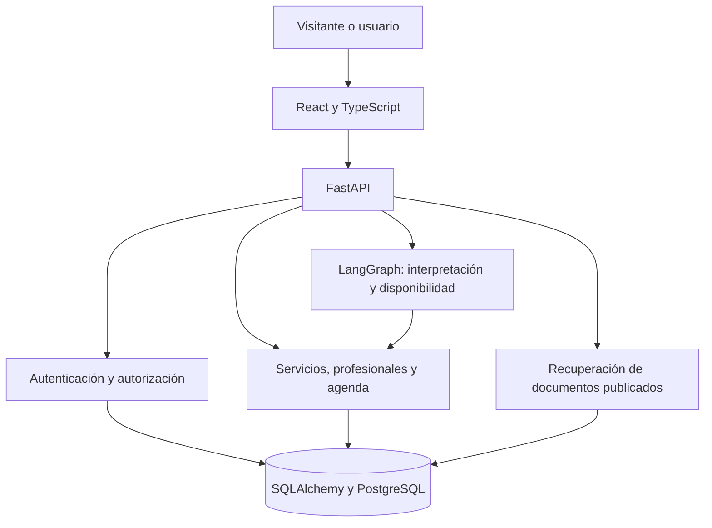

# Arquitectura de ORQENTIVA

## Componentes y responsabilidades

React muestra la interfaz, conserva el borrador de la conversación y solicita confirmación explícita. FastAPI valida entradas y permisos. SQLAlchemy coordina la persistencia. PostgreSQL es la base del desarrollo habitual. SQLite permite ejecutar las pruebas aisladas y una demostración portátil. Alembic versiona el esquema.

## Dos tipos de acceso

super_admin administra negocios y crea usuarios. business_admin opera sobre la empresa asociada a su cuenta. La API toma la empresa de la sesión en las rutas privadas. Los enlaces públicos toman la empresa del enlace y solo exponen catálogo reservable, disponibilidad y documentos publicados. Cambiar business_id en una instrucción del chat no concede permisos.

## Reserva conversacional

1. React envía mensaje y borrador a POST /book/{business_id}/chat.
2. El grafo interpreta servicio, profesional, fecha y hora mediante reglas.
3. La consulta de disponibilidad comprueba duración, horarios y solapamientos.
4. El chat devuelve datos faltantes, alternativas o una propuesta. Este recorrido no escribe reservas.
5. La persona confirma en React. La interfaz envía la propuesta a POST /book/{business_id} con request_key.
6. El backend revalida y persiste. Solo tras una respuesta correcta aparece «Cita confirmada».

La clave de solicitud evita duplicados por reintento. Una nueva solicitud a un turno ocupado recibe conflicto. En PostgreSQL, el bloqueo de negocio coordina las confirmaciones concurrentes. La validación SQLite no sustituye la de PostgreSQL.

## Consulta documental

Los documentos tienen empresa, título, texto y estado publicado. La recuperación filtra empresa y publicación antes de puntuar párrafos. Normaliza texto y usa términos/alias y cobertura. Devuelve citas literales, título y número de párrafo. No utiliza embeddings, base vectorial, LLM ni generación aumentada. Puede no reconocer paráfrasis complejas. No debe presentarse como un sistema generativo completo.

## Seguridad y límites

Contraseñas Argon2, tokens aleatorios de sesión cuyo hash se guarda en base de datos, cookies HttpOnly y SameSite=Strict, Secure por defecto. Las escrituras privadas validan Origin. La revocación y el estado del negocio se comprueban en servidor. Los límites de envíos/login/reservas son locales al proceso. No se implementaron MFA, restablecimiento de contraseña ni auditoría completa de eventos.

## Decisiones y aprendizaje

Separar autorización y presentación evita depender de botones ocultos. Separar propuesta y confirmación evita escrituras por mensajes ambiguos. Usar una referencia literal permite verificar el origen de cada respuesta. El flujo guiado ofrece comportamiento acotado y comprobable con coste de API de modelo inexistente, a cambio de menor flexibilidad lingüística.

La hipótesis de mejora de productividad frente a otros asistentes sigue sin evaluarse con usuarios reales. Las pruebas certifican únicamente los escenarios ejecutados.
