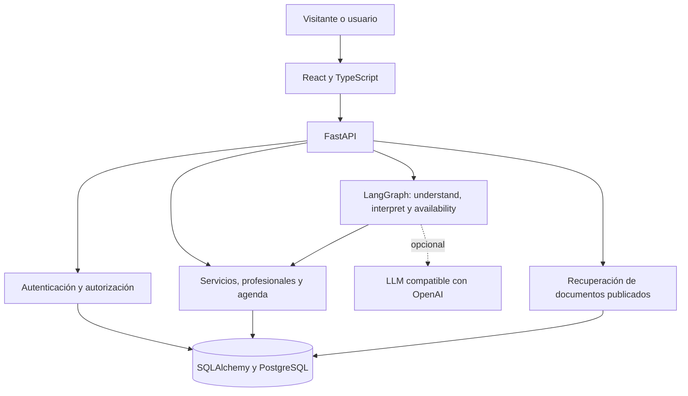

# Arquitectura de ORQENTIVA Technologies

## Componentes y responsabilidades

React muestra la interfaz, conserva el borrador de la conversación y solicita confirmación explícita. FastAPI valida entradas y permisos. SQLAlchemy coordina la persistencia. PostgreSQL es la base del desarrollo habitual. SQLite permite ejecutar las pruebas aisladas y una demostración portátil. Alembic versiona el esquema.

## Dos tipos de acceso

super_admin administra negocios y crea usuarios. business_admin opera sobre la empresa asociada a su cuenta. La API toma la empresa de la sesión en las rutas privadas. Los enlaces públicos toman la empresa del enlace y solo exponen catálogo reservable, disponibilidad y documentos publicados. Cambiar business_id en una instrucción del chat no concede permisos.

## Reserva conversacional

1. React envía mensaje y borrador a POST /book/{business_id}/chat.
2. El grafo de LangGraph ejecuta tres nodos. `understand` pide al LLM, si está configurado, una propuesta de servicio, profesional, fecha, hora y nombre en JSON. `interpret` aplica las reglas deterministas y usa la propuesta del LLM solo para los campos que las reglas no reconocieron. Cada campo del LLM se valida contra el catálogo del negocio; los ids inventados, fechas pasadas u horas mal formadas se descartan.
3. La consulta de disponibilidad comprueba duración, horarios y solapamientos.
4. El chat devuelve datos faltantes, alternativas o una propuesta. Este recorrido no escribe reservas.
5. La persona confirma en React. La interfaz envía la propuesta a POST /book/{business_id} con request_key.
6. El backend revalida y persiste. Solo tras una respuesta correcta aparece «Cita confirmada».

En el flujo de reservas, el LLM no escribe en la base de datos ni redacta la respuesta al cliente (la generación documental se describe más abajo), y el mensaje se le envía marcado como texto no confiable. Si falla, tarda más de 8 segundos, responde algo que no es JSON o se supera el límite de 20 llamadas por IP y minuto, el chat continúa solo con reglas.

La clave de solicitud evita duplicados por reintento. Una nueva solicitud a un turno ocupado recibe conflicto. En PostgreSQL, el bloqueo de negocio coordina las confirmaciones concurrentes. La validación SQLite no sustituye la de PostgreSQL.

## Consulta documental

Los documentos tienen empresa, título, texto y estado publicado. La consulta sigue el patrón RAG (SPEC-015):

1. **Recuperación.** Filtra empresa y publicación antes de puntuar párrafos. Normaliza texto y usa términos/alias y cobertura. Si no hay coincidencias y todos los párrafos del negocio caben en 6 000 caracteres, se pasan todos como candidatos.
2. **Generación.** Con el LLM activo, el modelo recibe la pregunta y solo los candidatos de ese negocio, y devuelve una respuesta breve con los ids de los párrafos usados.
3. **Validación.** El servidor rechaza citas a párrafos no enviados y cifras que no aparezcan en los párrafos citados. Si el modelo no responde, falla o se rechaza su respuesta, se devuelve el párrafo literal (modo extractivo).

No utiliza embeddings ni base vectorial: un negocio publica pocos párrafos y la recuperación léxica más el LLM cubre sinónimos sin costos añadidos. Las respuestas siempre muestran título y número de párrafo.

## Seguridad y límites

Contraseñas Argon2, tokens aleatorios de sesión cuyo hash se guarda en base de datos, cookies HttpOnly y SameSite=Strict, Secure por defecto. Las escrituras privadas validan Origin. La revocación y el estado del negocio se comprueban en servidor. Los límites de envíos/login/reservas son locales al proceso. No se implementaron MFA, restablecimiento de contraseña ni auditoría completa de eventos.

## Decisiones y aprendizaje

Separar autorización y presentación evita depender de botones ocultos. Separar propuesta y confirmación evita escrituras por mensajes ambiguos. Usar una referencia literal permite verificar el origen de cada respuesta. El LLM aporta flexibilidad lingüística (frases como «la semana que viene a media mañana»), mientras que las reglas, la validación contra el catálogo y la confirmación explícita mantienen el comportamiento comprobable. Sin clave de API el sistema funciona igual que antes, sin coste de modelo.

La hipótesis de mejora de productividad frente a otros asistentes sigue sin evaluarse con usuarios reales. Las pruebas certifican únicamente los escenarios ejecutados.
